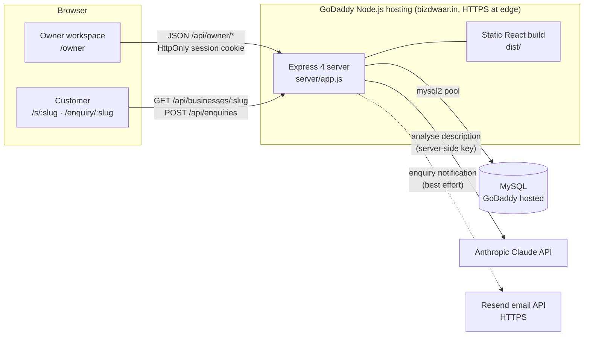
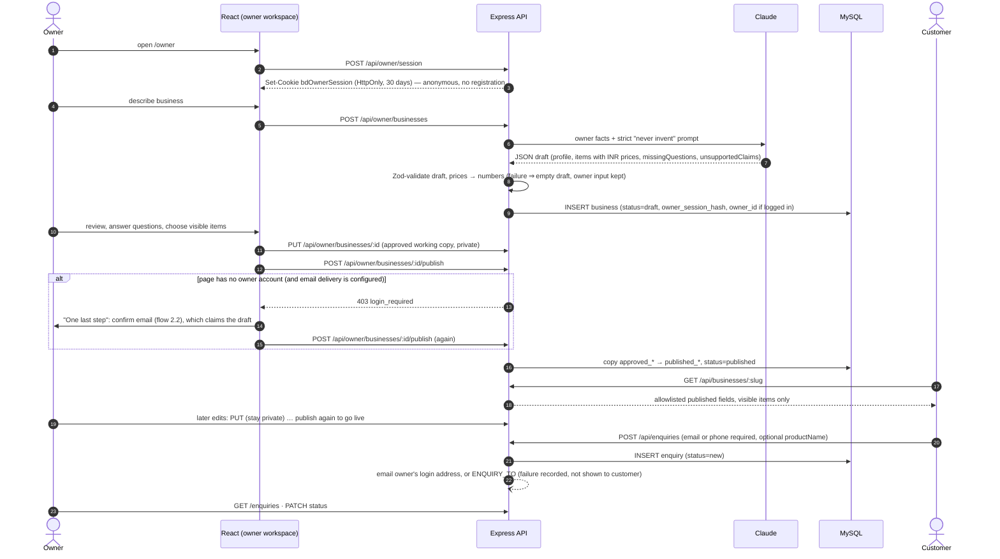
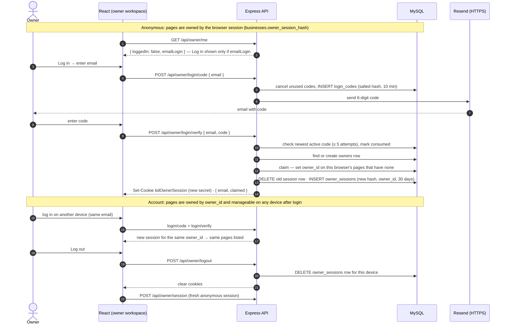
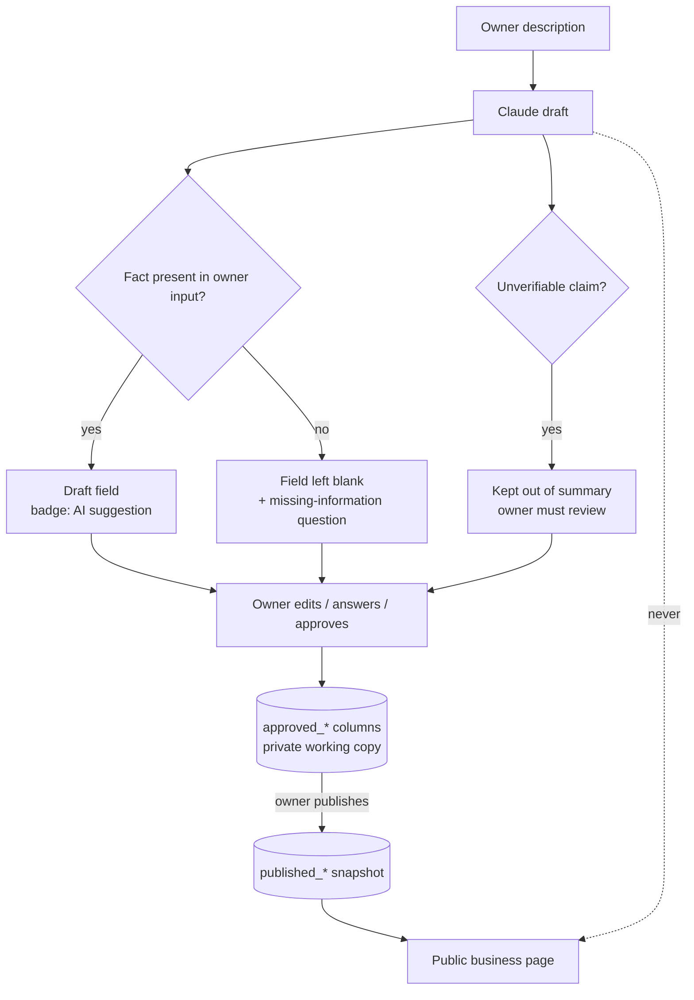
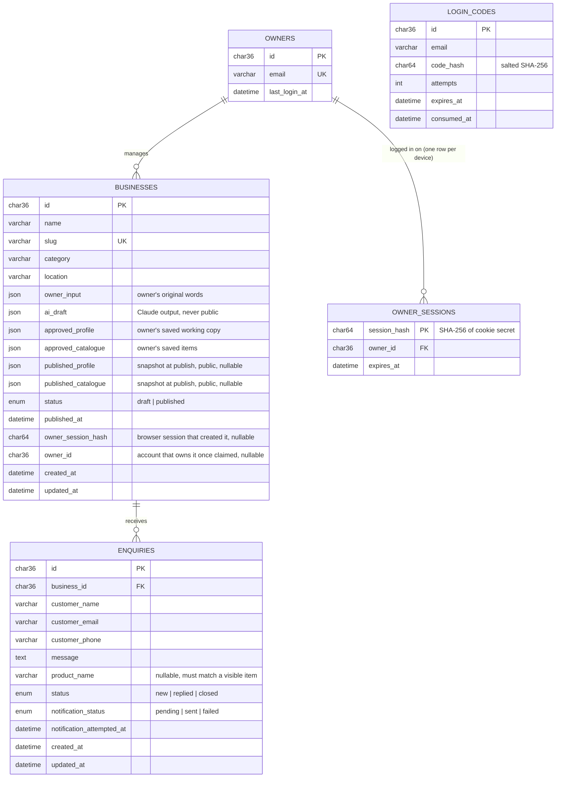
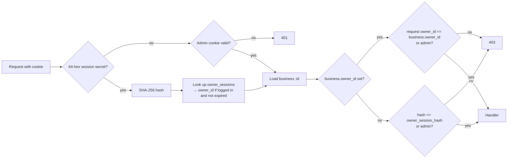

# Bizdwaar — Architecture

One document covering the high-level design (system, flows) and the low-level design (data model, API,
security). Diagrams are Mermaid and render on GitHub. Everything here describes code that exists in this
repository; planned work is listed separately under [Roadmap](#7-roadmap-not-built).

> The product calls the public page a **business page**; in code and API names it is a *storefront*.

---

## 1. System overview



- **One deployable unit.** Express serves both the API and the Vite-built React app (`dist/`), so the browser
  only ever talks to one origin. There is no separate frontend host and no CORS.
- **Secrets stay server-side.** The Claude key, database credentials and email API key never reach the client.
- **Email over HTTPS.** GoDaddy hosting blocks outbound SMTP (`connect EACCES …:587` in production logs), so
  login codes and enquiry notifications use Resend's HTTPS API. Nothing is sent until it is configured.
- **Shared price logic.** `shared/price.js` (INR parsing and `en-IN` formatting) is imported by both the
  server and the React build, so validation and display can't drift apart.
- **Stateless app tier.** Sessions are verified by hashing the cookie and comparing it with the database, so the
  server holds no session state. (The in-memory rate limiter is the only per-process state.)

---

## 2. Main flows

### 2.1 Describe → publish → enquiry



### 2.2 Owner access: anonymous session → optional email login → claim → logout



**Ownership rule** (`requireBusinessOwnership` in `server/middleware/ownerAuth.js`):

| Page state | Who can manage it |
|---|---|
| `owner_id` is NULL (unclaimed) | The browser whose session hash equals `owner_session_hash` |
| `owner_id` set (claimed or created while logged in) | Any session in `owner_sessions` for that `owner_id` (any device) — the anonymous browser no longer counts |
| Any page | The administrator (`OWNER_ADMIN_TOKEN` cookie) |

The workspace list (`GET /api/owner/businesses`) shows the account's pages plus this browser's unclaimed pages.
Logout is offered only to logged-in owners, so unclaimed pages are never orphaned by it.

---

## 3. AI trust design

The AI is a **drafting assistant with no authority to publish**. Trust is enforced in four layers:

| Layer | Mechanism | Where |
|---|---|---|
| Prompt | Use only owner-provided facts; prices, sizes, ingredients, certifications, stock, delivery and quality claims must be `null` if absent; a stated price is returned as a plain rupee number; list missing facts as questions; list unverifiable claims separately. | `server/services/claudeService.js` |
| Schema | Claude's JSON is parsed and validated with Zod. Text prices are converted to numbers; ranges or vague prices become `null` (asked, never guessed). Anything malformed is rejected, and the owner's input is kept with an empty draft. | `ClaudeOutputSchema` |
| Separation of data | `ai_draft` (what Claude said), `approved_*` (the owner's saved working copy) and `published_*` (the snapshot taken at publish) are stored separately. Only the published snapshot is ever public. | `businesses` table |
| UX | Fields show an *AI suggestion* or *Confirmed by you* badge. Missing facts become questions with **Answer** buttons. Flagged claims are kept out of the summary and must be reviewed before the publish button enables. Items start hidden; availability is only shown if the owner sets it. The preview is the real page. | `client/src/pages/OwnerReview.jsx` |



---

## 4. Data model



**JSON shapes**

```jsonc
// approved_profile  (published_profile has the same shape)
{ "businessName": "...", "description": "...", "category": "...", "location": "...",
  "contactEmail": "... | null", "contactPhone": "... | null" }

// approved_catalogue[] item  (published_catalogue has the same shape)
// price: INR amount as a number (1299, 250.5) or null = "Price on request".
// Rows saved before numeric prices may hold text such as "₹350"; it is read as INR on display.
{ "name": "...", "description": "...", "price": 1299, "unitOrSize": "200g | null",
  "attributes": ["..."], "publicVisible": false,
  "availability": "available | made_to_order | out_of_stock | null" }

// ai_draft
{ "businessSummary": "...", "suggestedCategory": "...", "catalogueDrafts": [ ... ],
  "missingQuestions": [{ "field": "price", "question": "..." }],
  "unsupportedClaims": ["..."], "analysedAt": "ISO date | null" }
```

**Migrations.** `server/db.js` creates the tables if they are missing, then runs *additive, idempotent*
migrations: it checks `information_schema` and only adds a column or index if it is absent. It never drops or
rewrites data. Existing rows get safe defaults (`owner_session_hash` NULL, `status` `'new'`,
`product_name` NULL, `published_profile` / `published_catalogue` NULL). A published page whose snapshot is
NULL keeps serving `approved_*` exactly as before, until the owner next publishes.

---

## 5. API reference

| Method | Path | Auth | Request | Response |
|---|---|---|---|---|
| GET | `/api/health` | — | — | `{ status: "ok" }` |
| POST | `/api/owner/session` | — | — | `201 { created: true }` + cookie, or `200 { created: false }` |
| GET | `/api/owner/businesses` | session | — | account pages + this browser's unclaimed pages: `{ businesses: [{ id, name, slug, status, … }] }` |
| POST | `/api/owner/businesses` | session, 10/h/IP | `{ businessName, businessType?, location?, description, productsRaw? }` | `201 { businessId, slug }` |
| GET | `/api/owner/businesses/:id` | owner | — | `{ business }` incl. `hasUnpublishedChanges` (no session hash) |
| PUT | `/api/owner/businesses/:id` | owner | `{ approvedProfile?, approvedCatalogue? }` — `price` a number (or numeric text) or `null` | `{ business }` · `400` with a readable message if a price isn't a rupee amount |
| POST | `/api/owner/businesses/:id/publish` | owner | — | copies the saved copy to the public snapshot · `{ slug, publishedAt }` · `422` if name/description missing · `403 login_required` if the page has no `owner_id` and email delivery is configured (admin exempt) |
| GET | `/api/owner/businesses/:id/enquiries` | owner | — | `{ enquiries: [...] }` (latest 50) |
| PATCH | `/api/owner/businesses/:id/enquiries/:enquiryId` | owner | `{ status }` | `{ enquiry }` · `404` if not this business's |
| POST | `/api/owner/login` | —, 10/15 min/IP | `{ token }` | admin cookie (optional fallback; token must be ≥ 32 chars) |
| POST | `/api/owner/login/code` | —, 10/15 min/IP, 3/email | `{ email }` | emails a 6-digit code · `503` if email can't be sent |
| POST | `/api/owner/login/verify` | —, 30/15 min/IP | `{ email, code }` | `{ email, claimed }` + new session cookie |
| GET | `/api/owner/me` | — | — | `{ loggedIn, email, isAdmin, emailLogin }` |
| POST | `/api/owner/logout` | — | — | deletes this device's `owner_sessions` row, clears cookies |
| GET | `/api/owner/admin/businesses` | admin | — | every page with status, owner email, enquiry counts |
| POST | `/api/ai/analyse` | session, 10/h/IP | as create | `{ draft }` (not saved) |
| GET | `/api/businesses/:slug` | — | — | published snapshot, allowlisted, visible items only, `currency: "INR"` |
| POST | `/api/enquiries` | —, 3/h/IP | `{ businessSlug, customerName, customerEmail?, customerPhone?, message, productName?, website(honeypot) }` — at least one of email / phone (8–15 digits) | `{ ok, message }` · `400` with a readable message |

Errors are JSON: `{ error, message }`, with status codes 400 (validation or malformed body), 401 (no session),
403 (not your business), 404 (including unknown API routes), 422 (publish blocked), 429 (rate limit) and 500.

---

## 6. Security



| Concern | Control |
|---|---|
| Owner identity | Server-generated 32-byte random secret; `HttpOnly`, `SameSite=Strict`, `Secure` (prod), 30 days. Only the SHA-256 hash is stored, and comparisons are constant-time. |
| Owner login | Email one-time code: salted SHA-256 at rest, 10-minute expiry, single use, 5 attempts, newest code cancels older ones, per-IP and per-email limits. Login rotates the session secret and stores it in `owner_sessions`; logout deletes it. |
| Ownership rule | A page with an `owner_id` is managed only by that account (any device). A page without one is managed only by the browser that created it until that browser logs in and claims it. Publishing requires an `owner_id` while email delivery is configured. The admin can manage and publish every page. |
| Authorisation | `requireOwner` and `requireBusinessOwnership` on every business route; enquiry updates are scoped by `business_id`. Changing an ID in the URL cannot reach another owner's data. |
| CSRF | `SameSite=Strict` cookies; JSON-only state-changing endpoints. |
| Data exposure | The public endpoint builds an explicit allowlist from the published snapshot. `owner_input`, `ai_draft`, unpublished edits, session hashes and enquiries are never public. |
| Abuse / cost | Rate limits on enquiries (3/h), creation (10/h), analysis (10/h) and admin login (10/15 min); enquiry honeypot; Zod validation and length limits on every input. Limits are keyed by client IP, so `TRUST_PROXY_HOPS` must match the real proxy setup. |
| Secrets | Environment variables only; `.env` and deploy scripts are git-ignored. |
| Resilience | Async errors go to a JSON error handler. The server starts listening before the DB connects, then keeps retrying with backoff. |
| Admin fallback | Optional `OWNER_ADMIN_TOKEN`, entered only at `/owner/admin` and never required for normal use. Disabled unless the token is at least 32 characters; constant-time comparison. |
| Testing | `npm test` runs the real routes and models against an in-memory database and a fake Claude endpoint, covering ownership (401/403/404), public data leakage and draft/live separation. |

---

## 7. Roadmap (not built)

These are **planned** and do not exist in the code today.

| Item | Notes |
|---|---|
| Connect own domain | Today the homepage links to GoDaddy domain search. Planned: show real availability and price in Bizdwaar, buy in the owner's name, and connect the domain to the business page. Fees would be disclosed; no partnership or commission is assumed. |
| Custom website service | Today an email enquiry from the homepage. Planned: an in-app request form and project tracking. |
| Phone / WhatsApp login | One-time codes by SMS or WhatsApp for owners without email. |
| Owner photo uploads | Replace the illustrative imagery and branded tiles with the owner's own product photos (needs durable storage, size/type limits, EXIF stripping). |
| Saved claim reviews | Persist the "I've reviewed this" ticks and enforce them on the server at publish. |
| WhatsApp notifications | Notify owners of enquiries on WhatsApp as well as email. |
| Shared rate-limit store | Redis or a DB-backed limiter for multi-instance deployments. |
