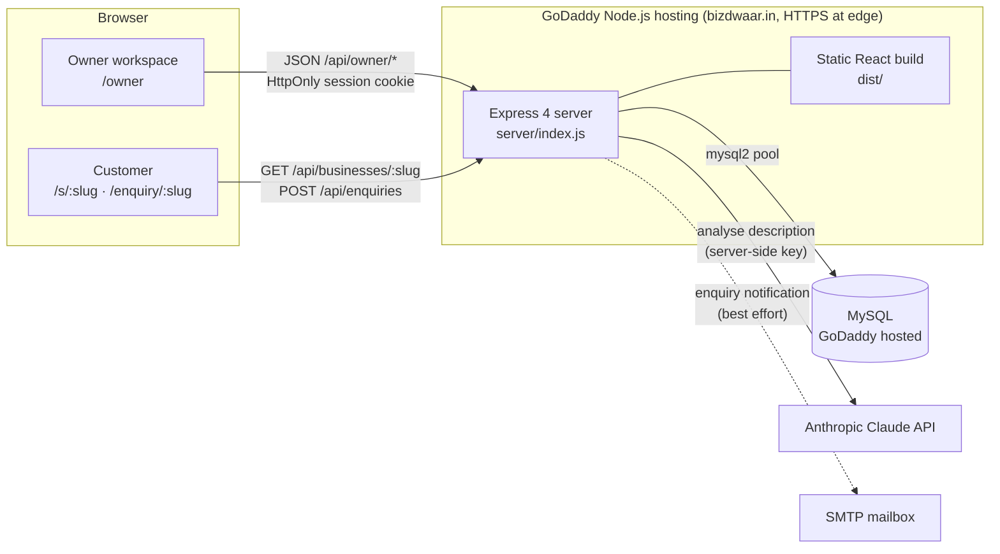
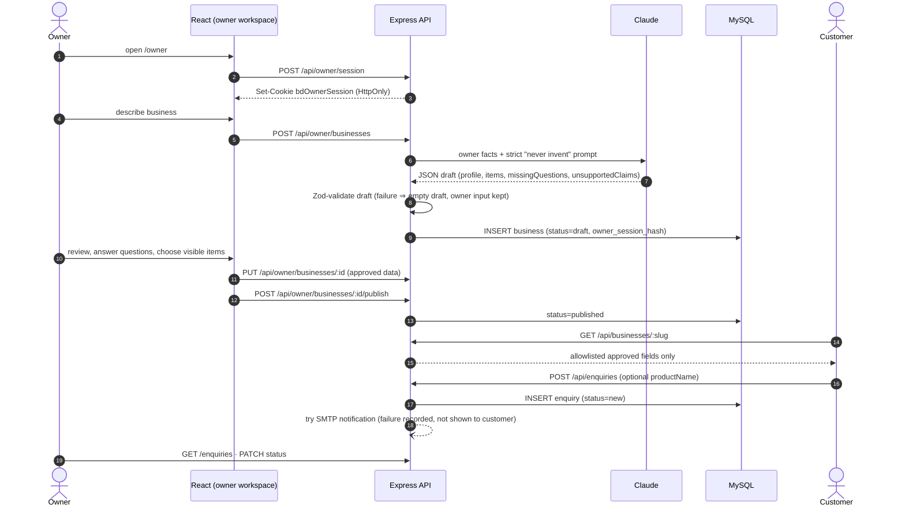
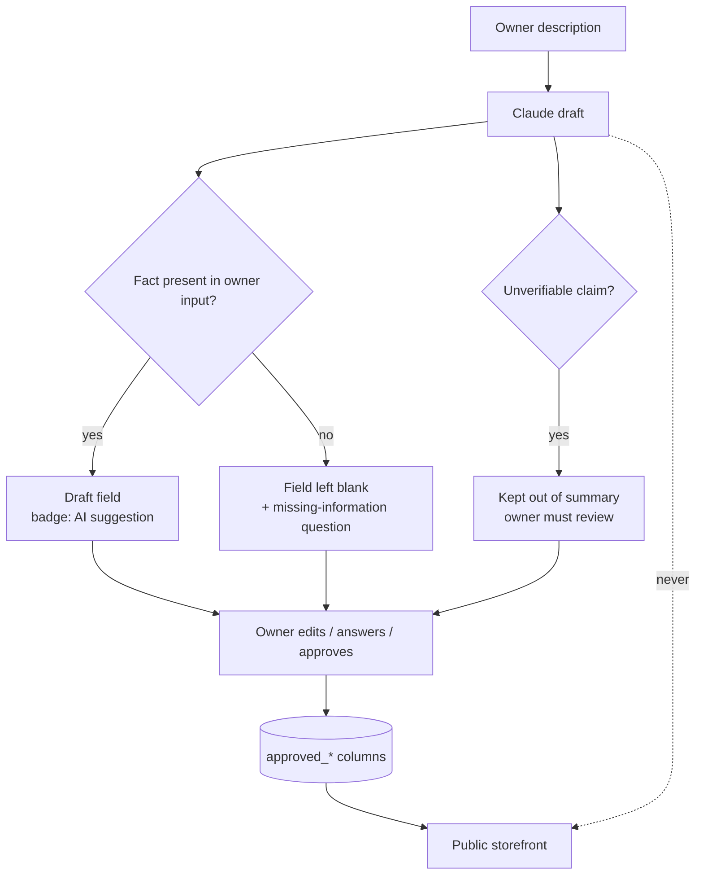
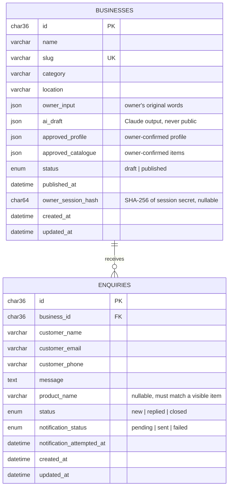
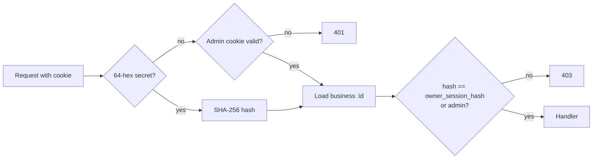

# Bizdwaar — Architecture

One document covering the high-level design (system, flows) and the low-level design (data model, API,
security). Diagrams are Mermaid and render on GitHub. Everything here describes code that exists in this
repository; planned work is listed separately under [Roadmap](#7-roadmap-not-built).

---

## 1. System overview



- **One deployable unit.** Express serves both the API and the Vite-built React app (`dist/`), so the browser
  only ever talks to one origin. There is no separate frontend host and no CORS.
- **Secrets stay server-side.** The Claude key, database credentials and SMTP password never reach the client.
- **Stateless app tier.** Sessions are verified by hashing the cookie and comparing it with the database, so the
  server holds no session state. (The in-memory rate limiter is the only per-process state.)

---

## 2. Main flow



---

## 3. AI trust design

The AI is a **drafting assistant with no authority to publish**. Trust is enforced in four layers:

| Layer | Mechanism | Where |
|---|---|---|
| Prompt | Use only owner-provided facts; prices, sizes, ingredients, certifications, stock, delivery and quality claims must be `null` if absent; list missing facts as questions; list unverifiable claims separately. | `server/services/claudeService.js` |
| Schema | Claude's JSON is parsed and validated with Zod. Anything malformed is rejected, and the owner's input is kept with an empty draft. | `ClaudeOutputSchema` |
| Separation of data | `ai_draft` (what Claude said) is stored separately from `approved_profile` / `approved_catalogue` (what the owner confirmed). Only approved data is ever public. | `businesses` table |
| UX | Fields show an *AI suggestion* or *Confirmed by you* badge. Missing facts become questions with **Answer** buttons. Flagged claims are kept out of the summary and must be reviewed before the publish button enables. Items start hidden; availability is only shown if the owner sets it. The preview is the real page. | `client/src/pages/OwnerReview.jsx` |



---

## 4. Data model



**JSON shapes**

```jsonc
// approved_profile
{ "businessName": "...", "description": "...", "category": "...", "location": "...",
  "contactEmail": "... | null", "contactPhone": "... | null" }

// approved_catalogue[] item
{ "name": "...", "description": "...", "price": "₹350 | null", "unitOrSize": "200g | null",
  "attributes": ["..."], "publicVisible": false,
  "availability": "available | made_to_order | out_of_stock | null" }

// ai_draft
{ "businessSummary": "...", "suggestedCategory": "...", "catalogueDrafts": [ ... ],
  "missingQuestions": [{ "field": "price", "question": "..." }],
  "unsupportedClaims": ["..."], "analysedAt": "ISO date | null" }
```

**Migrations.** `server/db.js` creates the tables if they are missing, then runs *additive, idempotent*
migrations: it checks `information_schema` and only adds a column or index if it is absent. It never drops or
rewrites data. Existing rows get safe defaults (`owner_session_hash` NULL, `status` `'new'`,
`product_name` NULL).

---

## 5. API reference

| Method | Path | Auth | Request | Response |
|---|---|---|---|---|
| GET | `/api/health` | — | — | `{ status: "ok" }` |
| POST | `/api/owner/session` | — | — | `201 { created: true }` + cookie, or `200 { created: false }` |
| GET | `/api/owner/businesses` | session | — | `{ businesses: [{ id, name, slug, status, … }] }` |
| POST | `/api/owner/businesses` | session, 10/h/IP | `{ businessName, businessType?, location?, description, productsRaw? }` | `201 { businessId, slug }` |
| GET | `/api/owner/businesses/:id` | owner | — | `{ business }` (no session hash) |
| PUT | `/api/owner/businesses/:id` | owner | `{ approvedProfile?, approvedCatalogue? }` | `{ business }` |
| POST | `/api/owner/businesses/:id/publish` | owner | — | `{ slug, publishedAt }` or `422` if name/description missing |
| GET | `/api/owner/businesses/:id/enquiries` | owner | — | `{ enquiries: [...] }` (latest 50) |
| PATCH | `/api/owner/businesses/:id/enquiries/:enquiryId` | owner | `{ status }` | `{ enquiry }` · `404` if not this business's |
| POST | `/api/owner/login` | — | `{ token }` | admin cookie (optional fallback) |
| POST | `/api/owner/logout` | — | — | clears cookies |
| POST | `/api/ai/analyse` | session, 10/h/IP | as create | `{ draft }` (not saved) |
| GET | `/api/businesses/:slug` | — | — | allowlisted public business, visible items only |
| POST | `/api/enquiries` | —, 3/h/IP | `{ businessSlug, customerName, customerEmail?, customerPhone?, message, productName?, website(honeypot) }` | `{ ok, message }` |

Errors are JSON: `{ error, message }`, with status codes 400 (validation), 401 (no session), 403 (not your
business), 404, 422 (publish blocked), 429 (rate limit) and 500.

---

## 6. Security



| Concern | Control |
|---|---|
| Owner identity | Server-generated 32-byte random secret; `HttpOnly`, `SameSite=Strict`, `Secure` (prod), 30 days. Only the SHA-256 hash is stored, and comparisons are constant-time. |
| Authorisation | `requireOwner` and `requireBusinessOwnership` on every business route; enquiry updates are scoped by `business_id`. Changing an ID in the URL cannot reach another owner's data. |
| CSRF | `SameSite=Strict` cookies; JSON-only state-changing endpoints. |
| Data exposure | The public endpoint builds an explicit allowlist. `owner_input`, `ai_draft`, session hashes and enquiries are never public. |
| Abuse / cost | Rate limits on enquiries (3/h), creation (10/h) and analysis (10/h); enquiry honeypot; Zod validation and length limits on every input. |
| Secrets | Environment variables only; `.env` and deploy scripts are git-ignored. |
| Resilience | Async errors go to a JSON error handler. The server starts listening before the DB connects, then retries. |
| Admin fallback | Optional `OWNER_ADMIN_TOKEN`, entered only at `/owner/admin` and never required for normal use. |

---

## 7. Roadmap (not built)

These are **planned** and do not exist in the code today.

| Item | Notes |
|---|---|
| Own custom domain | Owner searches for a domain via GoDaddy and sees real availability and price, buys it in the owner's name, and Bizdwaar connects it to the storefront. Fees would be disclosed; no partnership or commission is assumed. |
| Premium custom website | Paid design, extra pages and galleries, hosting and maintenance. |
| Owner accounts | Email or phone sign-in to manage storefronts across devices; claim existing browser-session storefronts. |
| Owner photo uploads | Replace the category-based illustrative imagery. |
| Per-owner notifications | Email or WhatsApp to each owner instead of one fixed `ENQUIRY_TO`, via a transactional email provider. |
| Shared rate-limit store | Redis or a DB-backed limiter for multi-instance deployments. |
